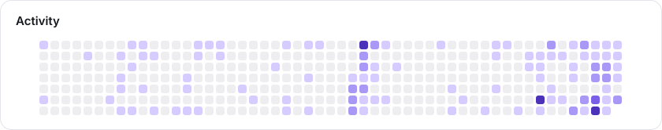
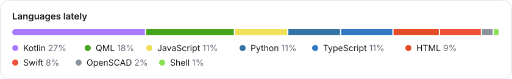
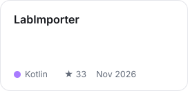
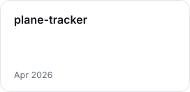
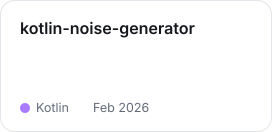
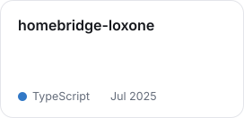
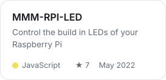
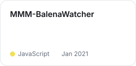

<!-- Generated by build.py from GitHub data and profile.toml, don't edit. Also shown on idoodler.de. -->

Full time developer who loves to build projects!

Always building fun projects · Smart Home · Apple by day · Linux by heart

[Mastodon](https://techhub.social/@idoodler) · [LinkedIn](https://www.linkedin.com/in/david-g%C3%B6lzh%C3%A4user-9112491b7) · [Instagram](https://instagram.com/idoodler) · [Reddit](https://reddit.com/user/idoodler) · [Stack Overflow](https://stackoverflow.com/users/1766321)

<picture><source media="(prefers-color-scheme: dark)" srcset="assets/stats-dark.svg"></picture>

<picture><source media="(prefers-color-scheme: dark)" srcset="assets/activity-dark.svg"></picture>

<picture><source media="(prefers-color-scheme: dark)" srcset="assets/languages-dark.svg"></picture>

### Recently active projects

<a href="https://github.com/idoodler/LabImporter"><picture><source media="(prefers-color-scheme: dark)" srcset="assets/project-0-dark.svg"></picture></a>
<a href="https://github.com/idoodler/nightscout-plasmoid"><picture><source media="(prefers-color-scheme: dark)" srcset="assets/project-1-dark.svg"></picture></a>
<a href="https://github.com/idoodler/plane-tracker"><picture><source media="(prefers-color-scheme: dark)" srcset="assets/project-2-dark.svg"></picture></a>
<a href="https://github.com/idoodler/kotlin-noise-generator"><picture><source media="(prefers-color-scheme: dark)" srcset="assets/project-3-dark.svg"></picture></a>
<a href="https://github.com/idoodler/homebridge-loxone"><picture><source media="(prefers-color-scheme: dark)" srcset="assets/project-4-dark.svg"></picture></a>
<a href="https://github.com/idoodler/openrgb-loxone"><picture><source media="(prefers-color-scheme: dark)" srcset="assets/project-5-dark.svg"></picture></a>
<a href="https://github.com/idoodler/MMM-RPI-LED"><picture><source media="(prefers-color-scheme: dark)" srcset="assets/project-6-dark.svg"></picture></a>
<a href="https://github.com/idoodler/iOS15-GetUserMedia"><picture><source media="(prefers-color-scheme: dark)" srcset="assets/project-7-dark.svg"></picture></a>
<a href="https://github.com/idoodler/MMM-BalenaWatcher"><picture><source media="(prefers-color-scheme: dark)" srcset="assets/project-8-dark.svg"></picture></a>

[All repositories →](https://github.com/idoodler?tab=repositories)

### Latest commits

- [Compile the qualitative row previews in debug builds only](https://github.com/idoodler/LabImporter/commit/586f081dc06028a921da366def3a734581da1a70) · LabImporter · 31 Oct 2026
- [Add end-to-end tests on the simulator and in Robolectric](https://github.com/idoodler/LabImporter/commit/defd150b84194a6227494bfc130934e6839da8c2) · LabImporter · 31 Oct 2026
- [Keep the trend screen open for results that aren't numbers](https://github.com/idoodler/LabImporter/commit/64e9b33ebb376ab8914bdd6c9415c15eb2aade45) · LabImporter · 31 Oct 2026
- [Add screenshots to README](https://github.com/idoodler/nightscout-plasmoid/commit/6874abc95aba6229c1dba732162b634c8b5f32e1) · nightscout-plasmoid · 24 Aug 2026
- [Initial commit of Nightscout Plasmoid](https://github.com/idoodler/nightscout-plasmoid/commit/b93e42ff0a10c280c45d5e89a9911d55e3c6bd47) · nightscout-plasmoid · 23 Aug 2026
- [Create README.md](https://github.com/idoodler/plane-tracker/commit/9034170d5021bcf655e99e7d6f646ac7a846c8af) · plane-tracker · 12 Apr 2026
- [addes support for base path](https://github.com/idoodler/kotlin-noise-generator/commit/366f9358802cf079d25fc0454cffedf75972070b) · kotlin-noise-generator · 21 Feb 2026
- [Fixed ci build](https://github.com/idoodler/kotlin-noise-generator/commit/7d107f5681f2db7e1ded780d7032bdbb39ba7dc3) · kotlin-noise-generator · 21 Feb 2026
- [Cleanup](https://github.com/idoodler/kotlin-noise-generator/commit/a4ace24e154eda4d438e60791ef7941a8d6f1e04) · kotlin-noise-generator · 21 Feb 2026
- [Initial commit](https://github.com/idoodler/homebridge-loxone/commit/077e60784b56c89e4a8bb38abb2c4ab11f4a8c61) · homebridge-loxone · 8 Jul 2025
